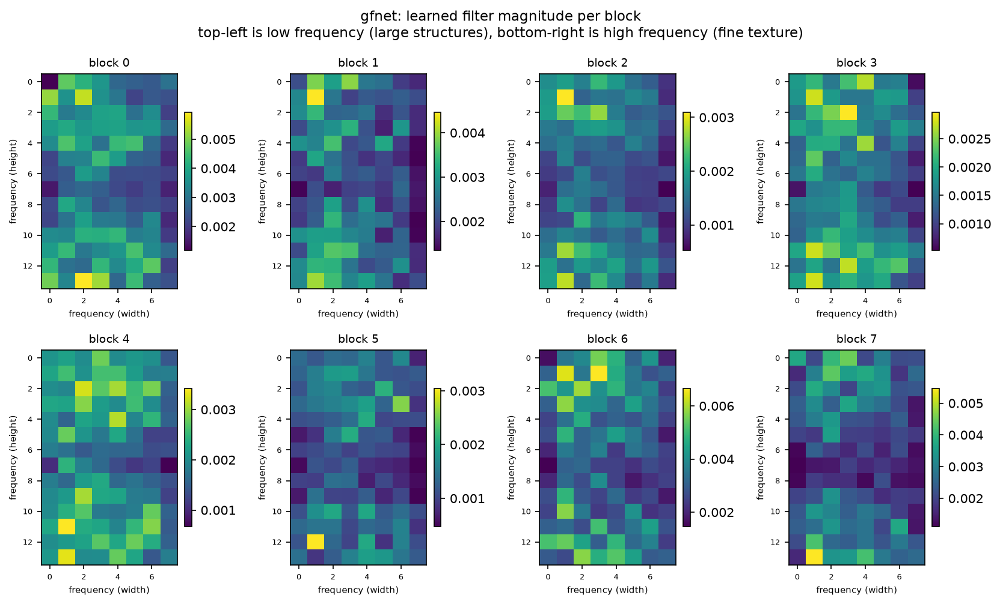
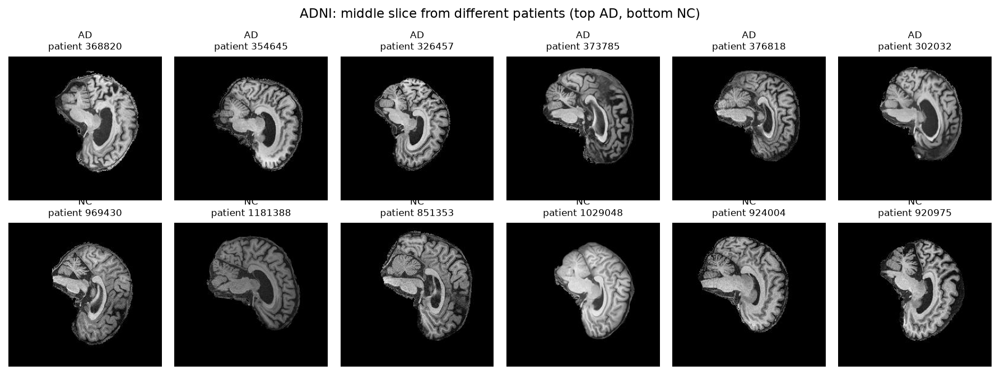
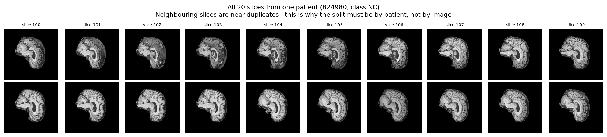
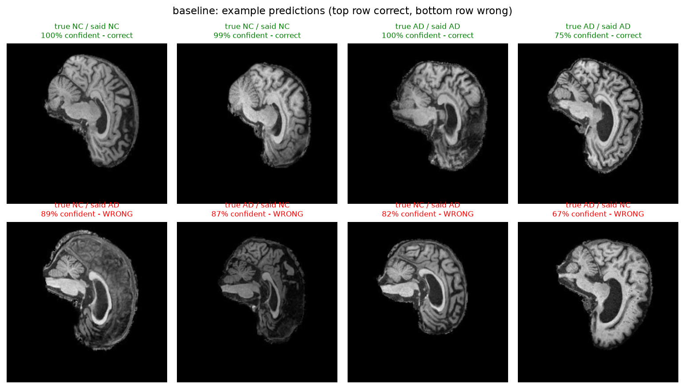
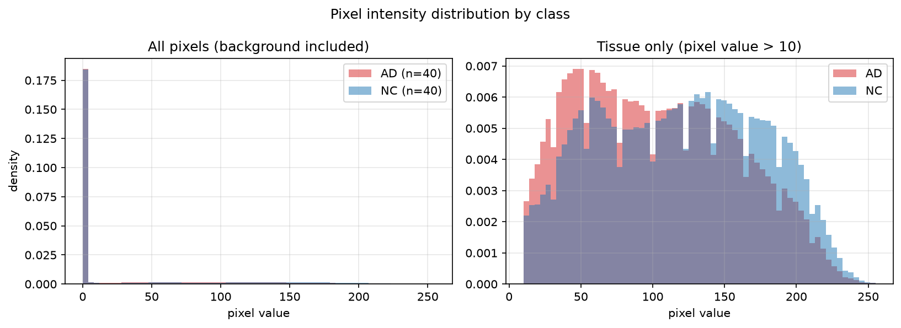
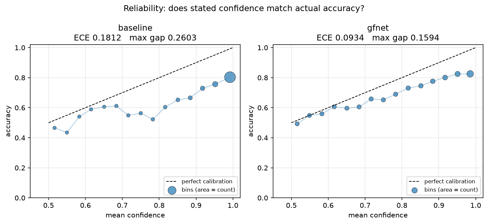
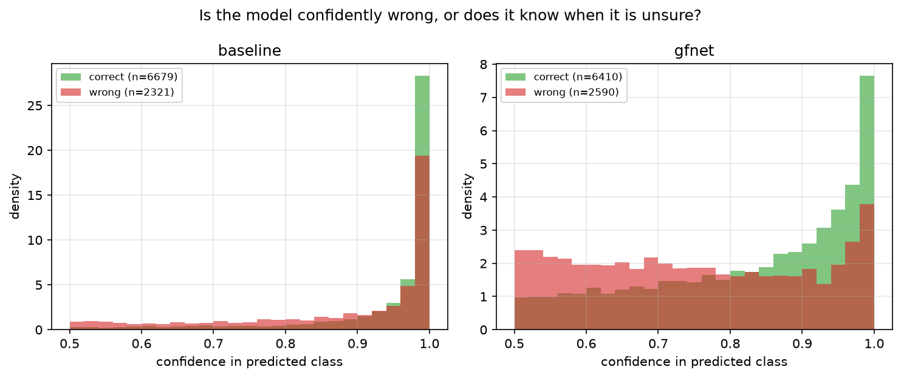
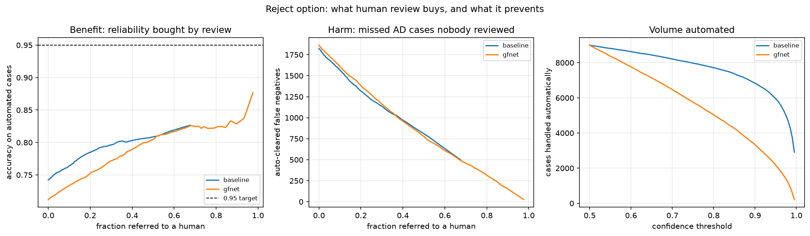
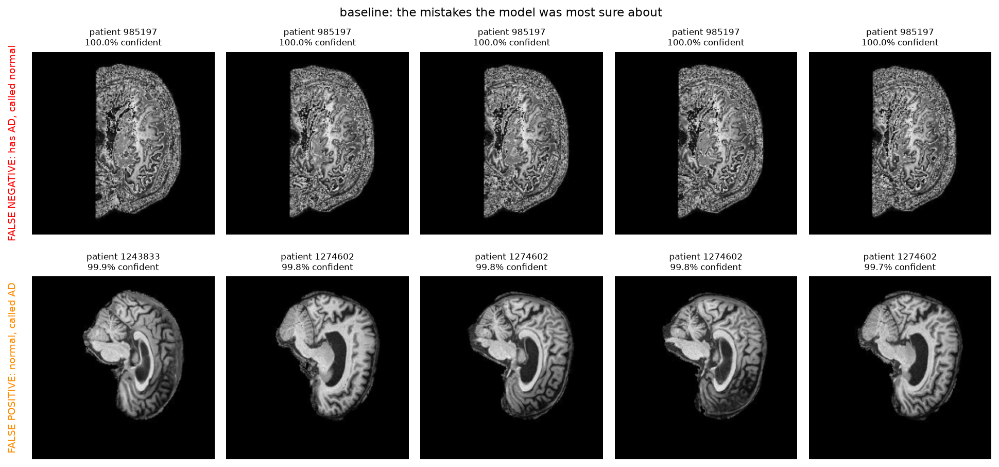

# GFNet for Alzheimer's Classification on ADNI Brain MRI

**Manav Sachdeva (s4967283).** COMP3710 Pattern Analysis Project.
Project 2.1 Classification. Model: GFNet. Difficulty: Hard.

---

## The problem

Alzheimer's disease destroys brain tissue. The damage shows up on a structural
MRI scan. The hippocampus gets smaller. The ventricles get larger and fill the
space. The cortex gets thinner. If a computer can find those changes early, a
clinician can start treatment sooner.

This project reads one 2D slice of a T1-weighted brain MRI. It puts the slice
in one of two classes: AD (Alzheimer's Disease) or NC (Cognitively Normal). The
data comes from the ADNI study. ADNI is a North American research programme
that has collected brain scans since 2004.

The hard part is not the difference between a sick brain and a healthy brain.
The hard part is that healthy brains differ a lot from person to person.
Healthy brains also get smaller with normal age. The model must separate "this
brain is sick" from "this brain belongs to a different person".

### The question this report answers

The assignment asks for more than accuracy. The open research question for this
field is about confidence.

> Does the confidence of the model match whether the model is correct? Or does
> the model stay confident when it is wrong? Can a confidence threshold
> automate the easy cases and send the unsure cases to a specialist?

A screening tool with 74% accuracy that knows when it is unsure is more useful
than one with 74% accuracy that always sounds certain. This report measures the
confidence of both models. It then says plainly whether you can trust that
confidence.

---

## How GFNet works

A Vision Transformer cuts an image into patches. It then uses self-attention,
so every patch can exchange information with every other patch. That global mix
is the strength of a transformer. But attention costs about n² operations for n
patches.

GFNet keeps the global mix and removes the attention. Each block does three
steps:

1. Take the 2D real FFT of the token grid. The result is complex.
2. Multiply the result by a learnable complex filter of the same shape. These
   weights are the parameters that the model learns. They are frequency gains.
3. Take the inverse FFT back to normal space.

The convolution theorem says that a multiply in the frequency domain equals a
convolution across the whole grid in normal space. So one multiply lets every
patch see every other patch. The cost is n log n instead of n².

### Why this architecture suits this disease

Alzheimer's atrophy is large-scale change in structure. The ventricles get
larger, the cortex gets thinner, the hippocampus gets smaller. These are
low-frequency features.

A model whose parameters are frequency weights is a good match. You can also
look inside it. `predict.py` plots the magnitude of each learned filter, so
this report can show which frequencies the model chose. A convolutional network
gives no equivalent picture.

### One detail that is easy to get wrong

A real-valued input has a symmetric spectrum. `torch.fft.rfft2` uses that fact
and returns only half of the frequencies. For a 14 × 14 token grid the output is
14 × **8**, not 14 × 14.

The learnable filter must match that shape. If the shape is wrong you get a
shape error, or worse, a silent broadcast that trains badly for no visible
reason. `modules.py` holds a self-test for this. The test sets every filter
weight to 1 + 0i and checks that the block returns its input without change. It
passes to within 4.8e-07, which is float32 rounding error.



*Each panel is the learned filter magnitude of one block. Top-left is low
frequency, which means large structures. Bottom-right is high frequency, which
means fine texture.*

---

## Feasibility review

*This is the one-page review I presented at the midpoint check-off, as Section 3
of the assignment specification requires.*

**Intended user.** A clinician who does early Alzheimer's screening. The
prototype does not replace the judgement of that clinician. It sorts scans into
two groups: cases the model is sure about, and cases it is not. The unsure cases
reach a specialist first.

**Purpose.** Put a 2D T1-weighted brain MRI slice in the AD class or the NC
class, and attach a confidence score that you can trust.

**Acceptance criteria.** I measured all of them on the held-out test split.

| # | Criterion | Target | Outcome |
|---|-----------|--------|---------|
| 1 | GFNet test accuracy, AD against NC | ≥ 0.80 | **Not met.** See Limitations |
| 2 | Baseline CNN trained on identical splits | reported | Met |
| 3 | Expected Calibration Error for both models | reported | Met |
| 4 | Reject-option rule that reaches ≥ 0.95 retained accuracy | ≤ 30% referral | **Not achievable.** See Calibration |
| 5 | Peak GPU memory and training time on one A100 | ≤ 16 GB, ≤ 2 h | Met. 2.32 GB, 18 min |

**Model choice.** GFNet (Rao et al., 2023) is a Hard-difficulty option. The
choice builds on the Fourier material in this course and on my own Demo 2 Part 1
work. There I measured a naive DFT at 34.2 s against an FFT at 0.13 ms for
N = 4096. The argument for GFNet against attention is the same argument one
level up.

**Baseline.** A plain four-block CNN written for this project, with 421,474
parameters. I did not tune it hard, so it stays an honest reference point and
not a weak target.

**Risks I found, and what happened.**

1. *Complexity of the GFNet filter block.* Closed by the FFT identity
   self-test, before I spent any GPU time.
2. *Cluster environment.* Confirmed to work. torch 2.14.0+cu130 on an
   A100-PCIE-40GB.
3. *Overfit on 915 training patients.* This risk happened. See the overfit
   section below for the diagnosis and the fix.

---

## Repository contents

```
PatternAnalysis-2026/
└── recognition/
    └── GFNet_s4967283/
        ├── README.md                 This report
        ├── progress_log.md           Dated record of each working day
        │
        ├── modules.py                GFNet and BaselineCNN, plus six self-tests
        ├── dataset.py                Patient-level splits, augmentation, loaders
        ├── train.py                  Training loop, validation, checkpoints
        ├── predict.py                Inference, confusion matrix, report figures
        │
        ├── audit_adni.py             Dataset audit, written before the loader
        ├── visualise_data.py         Raw data figures and a leakage measurement
        ├── brightness_baseline.py    One-feature classifier, audits for an artifact
        ├── evaluate_calibration.py   ECE, reliability, reject option, temperature
        ├── inspect_patient.py        Per-slice predictions for a named patient
        ├── try_ensemble.py           Combines the two models and measures the gain
        ├── audit_split_difference.py Compares the shipped train and test folders
        ├── find_duplicate_subjects.py Finds repeat scans of one person across splits
        ├── measure_leakage_impact.py Counts the leaked patients and scores without them
        │
        ├── run_smoke.sh              SLURM, two epochs, run before any full job
        ├── run_train.sh              SLURM, full run. Args: model seed epochs aug
        ├── run_figures.sh            SLURM, rebuilds every figure from checkpoints
        │
        └── figures/
            ├── fig1_class_comparison.png        Example slices, AD against NC
            ├── fig2_one_patient_all_slices.png  All 20 slices of one patient
            ├── fig3_class_averages.png          Mean image per class
            ├── fig4_intensity_histograms.png    Pixel intensity by class
            ├── predictions_baseline.png         Example predictions
            ├── predictions_gfnet.png
            ├── failures_baseline.png            Most confident mistakes
            ├── failures_gfnet.png
            ├── filters_gfnet.png                Learned frequency filters
            ├── calibration_reliability.png      Reliability diagram
            ├── calibration_confidence.png       Confidence, right against wrong
            ├── reject_option_curves.png         Retained accuracy by referral rate
            ├── calibration_results.json         Every calibration number
            ├── test_predictions_*.npz           Saved test probabilities
            └── validation_predictions_*.npz     Saved validation probabilities
```

Model checkpoints and training logs are not committed. The spec forbids it and
they are regenerable from `run_train.sh`.

| File | Purpose |
|------|---------|
| `modules.py` | `BaselineCNN` and `GFNet` definitions, plus six self-tests |
| `dataset.py` | Data loader with patient-level splits and augmentation |
| `train.py` | Training loop, validation, checkpoints, metric plots |
| `predict.py` | Loads a checkpoint, runs inference, draws the report figures |
| `audit_adni.py` | Dataset inspection, written before the loader |
| `visualise_data.py` | Four figures of the raw data, plus a leakage measurement |
| `brightness_baseline.py` | A one-feature classifier, used to audit the result |
| `evaluate_calibration.py` | ECE, reliability, reject-option sweep, temperature scaling |
| `inspect_patient.py` | Per-slice predictions for one patient, used for the error autopsy |
| `try_ensemble.py` | Combines the two models and measures what that buys |
| `audit_split_difference.py` | Compares the shipped folders on eight measures, with effect sizes |
| `find_duplicate_subjects.py` | Detects repeat scans of one person, using test as a control |
| `measure_leakage_impact.py` | Counts leaked patients and recomputes accuracy without them |
| `run_smoke.sh` | SLURM smoke test, two epochs, run before any full job |
| `run_train.sh` | SLURM training run. Takes model, seed, epochs and augmentation |
| `run_figures.sh` | SLURM job that rebuilds every figure from a pair of checkpoints |

---

## Dependencies and reproducibility

I measured these on the Rangpur HPC cluster.

| Package | Version |
|---------|---------|
| Python | 3.11 |
| torch | 2.14.0+cu130 |
| torchvision | matching cu130 build |
| CUDA | 13.0 |
| numpy | used in `train.py`, `predict.py` and the analysis scripts only |
| matplotlib | for all figures |
| Pillow | image loading |

Hardware: one NVIDIA A100-PCIE-40GB.

**Note on `modules.py`.** The assignment says the model code must depend only on
PyTorch. `modules.py` imports nothing else. NumPy appears in `train.py`,
`predict.py` and the analysis scripts, where the assignment allows it.

### What is fixed, and what is not

`set_all_seeds` fixes the seed for Python `random`, for NumPy and for torch.
It fixes the CUDA seed as well. The train and validation split uses the same
seed, so the same patients go to the same split on every run.

An honest limit: `cudnn.benchmark` stays on. It picks the fastest convolution
algorithm for the hardware, and that choice is not guaranteed to be the same
between runs. So the results repeat to within a small margin. They are not
bit-exact. `deterministic=True` would fix that, at a clear cost in speed.

---

## How to run

```bash
# Inspect the dataset
python audit_adni.py

# Produce the data figures
python visualise_data.py --data-root /home/groups/comp3710/ADNI/AD_NC --output-dir figures

# Check the models before you spend GPU time
python modules.py

# Train (SLURM). Arguments: model, seed, epochs, augmentation
sbatch run_train.sh baseline 42 80 strong
sbatch run_train.sh gfnet 42 80 strong

# Run a trained model and draw the figures
python predict.py --model gfnet --checkpoint outputs_gfnet_seed42_strong/best_gfnet.pt --output-dir figures

# Produce the validation predictions that temperature scaling needs
python predict.py --model gfnet --checkpoint outputs_gfnet_seed42_strong/best_gfnet.pt --split validation --no-figures --output-dir figures

# The dilemma investigation
python evaluate_calibration.py \
  --predictions figures/test_predictions_baseline.npz figures/test_predictions_gfnet.npz \
  --val-predictions figures/validation_predictions_baseline.npz figures/validation_predictions_gfnet.npz \
  --names baseline gfnet --output-dir figures
```

`predict.py` and `train.py` need a GPU. Run them through SLURM. Do not run them
on the login node.

---

## The data

```
/home/groups/comp3710/ADNI/AD_NC/
    train/AD   10,400 images from   520 patients
    train/NC   11,120 images from   556 patients
    test/AD     4,460 images from   223 patients
    test/NC     4,540 images from   227 patients
```

File names use the form `<patientID>_<slice>.jpeg`, for example
`1003730_100.jpeg`. Every patient gives exactly 20 slices. Images are 256 × 240,
greyscale, with pixel values from 0 to 255.

Teaching staff confirmed that the number before the underscore is a **patient**
ID, and not a scan ID or a session ID. That matters, because ADNI follows people
over many years and can scan the same person more than once.



### The splits, and why they are built this way

Each patient gives 20 slices cut from one 3D scan, so those 20 images look very
similar to each other.



A random split at image level would spread the slices of one person across train
and validation. The model could then score well because it recognises the
patient and not the disease. Validation accuracy would look excellent for the
wrong reason, and the test score would then collapse with no clear cause.

So every split happens at **ID** level. I choose which IDs go where first, and
all 20 slices of an ID follow that choice. `check_no_patient_overlap` raises an
`AssertionError` if an ID appears in two splits. It crashes and does not warn,
because if that check fires, every number after it is worthless.

**That is correct, and it is not enough.** The section "The filename ID is a
scan ID, not a person ID" below shows that one person holds several consecutive
IDs, so this check passes while the same person sits in two splits. I measured
how much that costs and report the corrected numbers there.

| Split | Images | Patients | NC | AD |
|-------|--------|----------|-----|-----|
| train | 18,300 | 915 | 9,460 | 8,840 |
| validation | 3,220 | 161 | 1,660 | 1,560 |
| test | 9,000 | 450 | 4,540 | 4,460 |

The test split comes exactly as shipped, and I never touched it during
development. The audit confirmed that it shares no patients with the train
folder.

Validation holds 15.0% of the train patients, stratified by class: 78 of 520 AD
patients and 83 of 556 NC patients. Both are within a tenth of a percent of 15%.

Class balance is NC 51.7% and AD 48.3%. That is mild enough that weighted loss
or resampling is not needed. I measured it and did not assume it.

### Preprocessing

**Resize 256 × 240 to 224 × 224.** GFNet needs a fixed square input, because it
works on a grid of patches. I resize and do not crop. A crop could remove the
outer cortex, and that is the tissue that atrophies in Alzheimer's. The stretch
is the same for every image, so the model sees a consistent world.

**Normalisation.** I measured these values over 2,000 train images. I used the
train split only, so nothing leaks in from validation or test.

```
PIXEL_MEAN = 0.1159
PIXEL_STD  = 0.2236
```

The mean is low because these slices are mostly black background. With
placeholder values of 0.5 the normalised range was −1.000 to 0.953, which
squeezed the brain tissue into a narrow band. With the measured values the range
is −0.518 to 3.849. Background sits near −0.52 and tissue spreads across the
positive range.

**Augmentation.** There are two settings. Select one with `--augmentation`.

| Transform | normal | strong |
|---|---|---|
| Horizontal flip | p = 0.5 | p = 0.5 |
| Rotation | ±5° | ±10° |
| Translation | ±5% | ±10% |
| Scale | none | 0.9 to 1.1 |
| Brightness and contrast jitter | none | ±25% |

The brightness jitter is not arbitrary. The brightness experiment below shows
that average intensity carries real signal, which means the model can lean on
brightness as a shortcut. Random brightness during training removes that
shortcut.

An honest caution about the horizontal flip. Alzheimer's atrophy is not always
symmetric between the two hemispheres, so a mirror image does lose a little real
signal. I kept the flip because the extra variety helps more at this dataset
size. But that choice deserves an ablation and not an assumption.

---

## Results

All numbers come from the held-out test split: 9,000 slices from 450 patients.
No model saw them during training or model selection.

### Headline comparison

Both models trained for 80 epochs, seed 42, learning rate 3e-4, batch size 64,
strong augmentation, weight decay 1e-3. The splits are identical.

| Measure | BaselineCNN | GFNet |
|---------|-------------|-------|
| Test accuracy (slice) | **0.7421** | 0.7122 |
| Test accuracy (patient) | **0.7511** | 0.7444 |
| Macro F1 | **0.7357** | 0.7069 |
| AD precision | **0.8411** | 0.7815 |
| AD recall | **0.5913** | 0.5821 |
| NC precision | 0.6892 | 0.6717 |
| NC recall | **0.8903** | 0.8401 |
| Best validation accuracy | 0.9028 | 0.7891 |
| Best epoch (of 80) | 79 | 61 |

The baseline wins on slice accuracy by 3.0 points. At patient level the gap
falls to 0.7 points. GFNet converged at epoch 61. The baseline was still better
at epoch 79.

### Resource profile

| Measure | BaselineCNN | GFNet | Ratio |
|---------|-------------|-------|-------|
| Trainable parameters | 421,474 | 4,788,482 | 11.4× |
| Peak GPU memory | 2.32 GB | 1.58 GB | 0.68× |
| Inference rate | 12,415 img/s | 5,672 img/s | 0.46× |
| Inference latency | 0.081 ms/img | 0.176 ms/img | 2.2× |
| Seconds per epoch | 13.6 | 14.1 | 1.03× |
| Total training time | 18.1 min | 19.0 min | 1.05× |

**GFNet uses less memory, and it has 11.4 times more parameters.** Parameters
and activations are separate costs. The first convolution of the baseline holds
a 224 × 224 × 32 feature map, which is about 1.6 million values per image.
GFNet reduces the image to 196 tokens of 256 values at once, which is about 50
thousand values. The baseline carries large spatial maps through its early
layers. GFNet carries a small token grid all the way through.



---

## Investigation of the open research dilemma

### Does the model learn anatomy, or brightness?

The intensity histograms show that AD tissue is darker than NC tissue on
average. That raised a question I had to answer before I trusted any result.
Does the model read anatomy, or does it read brightness?



So I built the simplest classifier I could. `brightness_baseline.py` uses one
number per slice, which is the mean intensity of the tissue pixels. It fits the
threshold on the train split only.

| Classifier | Test accuracy | What it uses |
|---|---|---|
| Chance | 0.500 | nothing |
| Mean tissue brightness | 0.585 | one number per slice |
| GFNet | 0.7122 | learned frequency filters |
| BaselineCNN | 0.7421 | learned convolution features |

The CNN adds **15.7 points** over the brightness rule, so the network learns
real structure. But 0.585 is above chance, so about 8.5 points of the signal is
average brightness. An honest account of this result needs both numbers.

This measurement is also the reason for the brightness jitter in the strong
augmentation setting.

### Does the confidence mean anything?

This is the core of the dilemma. I measured it with `evaluate_calibration.py`.

| Measure | BaselineCNN | GFNet |
|---|---|---|
| Expected Calibration Error | 0.1812 | **0.0934** |
| Worst single bin gap | 0.2603 | **0.1594** |
| Mean confidence when correct | 0.9382 | 0.8281 |
| Mean confidence when wrong | 0.8803 | 0.7499 |
| Separation | 0.0579 | **0.0782** |



**GFNet is almost twice as well calibrated as the baseline.** Its calibration
error is 0.0934 against 0.1812, and its worst single bin is out by 0.159 and not
by 0.260. GFNet is also less overconfident in absolute terms. When GFNet is
wrong it claims 75% certainty, not 88%.

This is the clearest result in the report, and it goes against the accuracy
comparison. The baseline predicts better. GFNet has the better idea of what it
does not know.

**Even so, you cannot automate on either confidence score.** The separation
between right and wrong predictions is 0.078 for GFNet. That is 35% better than
the 0.058 of the baseline. It is still far too small for a threshold to split
the two groups cleanly.



### Temperature scaling

Temperature scaling divides the logits by one learned number before the softmax.
It changes no prediction, so accuracy stays the same. But it can make the
confidence honest.

I fit the temperature on the **validation** split. A fit on test, followed by a
report of test calibration, would be a tune on the test set. That is the same
mistake that the patient-level split exists to avoid.

| Model | Temperature | ECE before | ECE after | Change | Accuracy |
|---|---|---|---|---|---|
| BaselineCNN | 1.20 | 0.1812 | 0.1651 | −8.9% | unchanged |
| GFNet | 1.11 | 0.0934 | 0.0787 | −15.7% | unchanged |

A temperature above 1 means the model was overconfident. Both models were, and
both only mildly. Accuracy did not move for either model, which is the expected
behaviour and a check that the implementation is correct.

GFNet gains more from the fit than the baseline does, at 15.7% against 8.9%. So
some of the overconfidence of the baseline is structural, and a single global
scale does not remove it.

**Strong augmentation did most of the work that temperature scaling would have
done.** I ran the same fit on the normal-augmentation models earlier in the
project. The numbers were very different.

| Run | Temperature | ECE before | ECE after | Change |
|---|---|---|---|---|
| GFNet, normal aug | 1.90 | 0.1819 | 0.1102 | −39% |
| GFNet, strong aug | 1.11 | 0.0934 | 0.0787 | −16% |
| BaselineCNN, normal aug | 1.36 | 0.2164 | 0.1963 | −9% |
| BaselineCNN, strong aug | 1.20 | 0.1812 | 0.1651 | −9% |

The fitted temperature for GFNet fell from 1.90 to 1.11. A temperature near 1
means there is little global overconfidence left to remove. Augmentation and
temperature scaling treat the same problem. Augmentation treats it better,
because it also raises accuracy, and temperature scaling cannot.

So the order matters. Fix the training first, then scale the temperature on
what is left.

### Patient-level evaluation

A clinician classifies a patient and not a slice. Each patient gives 20 slices,
so the mean of those 20 probabilities is the clinically useful read-out.

| Model | Slice | Patient | Gain |
|---|---|---|---|
| BaselineCNN | 0.7421 | **0.7511** | +0.9 pts |
| GFNet | 0.7122 | 0.7444 | **+3.2 pts** |

GFNet gains more than three times as much from the mean. That tells us something
about the shape of the errors of each model. You can see the shape when you
count how each patient fails.

| Model | All 20 slices correct | All 20 slices wrong |
|---|---|---|
| BaselineCNN | 226 | 40 |
| GFNet | 157 | **28** |

The mean only helps a patient whose slices disagree with each other. In the
all-wrong group the model has a consistent and confident misread of the anatomy
of that person. No mean fixes that.

**GFNet gets all 20 slices wrong for 30% fewer patients: 28 against 40.** A
patient who is wrong on all 20 slices is a patient the system gets wrong every
time. There is no internal disagreement to flag the case for review. That is a
real safety property, and GFNet holds it with a lower slice accuracy.

The 3.0-point gap in slice accuracy falls to 0.7 points once you evaluate the
way a clinic would.

### The reject option

The rule is simple. If confidence is at or above a threshold, accept the answer
automatically. Below the threshold, send the case to a specialist.



**Acceptance criterion 4 is not achievable.** No threshold reaches 0.95 accuracy
on the automatic cases and refers 30% of cases or fewer. That follows from the
confidence separation of 0.058. The two groups overlap too much.

The three outcomes do not cost the same. That is why overall accuracy is the
wrong thing to optimise.

| Outcome | Cost |
|---|---|
| False positive, referred | A few minutes of specialist time |
| False positive, auto-flagged | Unnecessary follow-up, patient distress |
| **False negative, auto-cleared** | **A patient goes home with no diagnosis. Nobody checks again.** |

### The decision threshold should move

Both models prefer to say "normal". A move of the AD decision threshold below
0.5 trades NC recall for AD recall.

I measured this on the baseline.

| AD threshold | AD recall | AD precision | NC recall | Accuracy | AD cases missed |
|---|---|---|---|---|---|
| **0.10** | **0.6899** | 0.7598 | 0.7857 | **0.7382** | **1,383** |
| 0.20 | 0.6370 | 0.7909 | 0.8346 | 0.7367 | 1,619 |
| 0.30 | 0.6049 | 0.8149 | 0.8650 | 0.7361 | 1,762 |
| 0.40 | 0.5744 | 0.8315 | 0.8857 | 0.7314 | 1,898 |
| 0.50 (default) | 0.5390 | 0.8492 | 0.9059 | 0.7241 | 2,056 |
| 0.60 | 0.5074 | 0.8628 | 0.9207 | 0.7159 | 2,197 |

At a threshold of 0.10 the model misses 1,383 AD slices and not 2,056. That is
**673 fewer missed cases**, and accuracy goes slightly up and not down.

The default of 0.5 is the wrong operating point for a screening tool.

Note what this does not do. Accuracy stays near 0.73 at every threshold. The
threshold moves errors between the classes. It does not add power to separate
them.

### Overfit: the diagnosis and the fix

The gap from validation to test got wider as training went on. That is the mark
of a model that fits its training group and does not learn something general.

| Baseline run | Validation | Test | Gap |
|---|---|---|---|
| 30 epochs, normal aug | 0.8894 | 0.7241 | 0.165 |
| 80 epochs, normal aug | 0.9326 | 0.7360 | **0.197** |
| 80 epochs, strong aug, weight decay 1e-3 | 0.9028 | 0.7421 | **0.161** |

First I checked whether the two shipped folders differ. The intensity histograms
for the train and test splits look the same, so a shift in the distribution is
not the cause.

The fix was stronger augmentation plus ten times the weight decay. Every measure
moved the right way.

| Measure | Normal aug | Strong aug | Change |
|---|---|---|---|
| Validation | 0.9326 | 0.9028 | −3.0 pts |
| Test (slice) | 0.7360 | 0.7421 | +0.6 pts |
| Test (patient) | 0.7422 | 0.7511 | +0.9 pts |
| Gap | 0.197 | 0.161 | −3.6 pts |
| AD recall | 0.5466 | 0.5913 | **+4.5 pts** |
| Macro F1 | 0.7257 | 0.7357 | +1.0 pts |
| ECE | 0.2164 | 0.1812 | −16% |
| Confidence separation | 0.0408 | 0.0579 | **+42%** |

Validation fell and test rose. That is what less overfit looks like. AD recall
gained the most, and that is the measure that matters in a clinic. It means 199
fewer missed Alzheimer's cases.

---

## Error autopsy

`predict.py` selects the mistakes that the model was **most confident** about,
because those are the dangerous ones. A mistake at 51% confidence goes to a
human under any sensible threshold. A mistake at 99% confidence does not.

`inspect_patient.py` then prints every slice of a named patient for both
models. That separates a patient the model is unsure about from a patient the
model is confidently and completely wrong about.



### Finding 1. The baseline reached P(AD) = 0.0000 on a patient who has AD

Patient 985197 has Alzheimer's disease. The baseline gave this output.

| Model | Correct slices | Mean P(AD) | Min | Max |
|---|---|---|---|---|
| BaselineCNN | **0 of 20** | **0.0000** | 0.0000 | 0.0000 |
| GFNet | 0 of 20 | 0.0086 | 0.0010 | 0.0290 |

Every one of the 20 slices returned a probability below 0.00005. The softmax
saturated. The model did not report low confidence in Alzheimer's. It reported
none at all, twenty times, on twenty different images of a sick brain.

GFNet is also wrong on all 20 slices, and it is wrong by a factor of about 30
less. It never claims certainty.

This single patient is the clearest answer to the research question in this
report. A confidence score that reads 1.0000 while the answer is wrong carries
no information at all.

### Finding 2. Every catastrophic failure is a missed AD case

I listed the ten worst total failures for each model. A total failure is a
patient the model gets wrong on all 20 slices.

**All twenty entries, across both models, are patients who have AD.** Not one
healthy patient appears in either list.

| Model | Worst patient | True class | Mean distance from the truth |
|---|---|---|---|
| BaselineCNN | 985197 | AD | 1.0000 |
| BaselineCNN | 1240482 | AD | 0.9996 |
| BaselineCNN | 1398870 | AD | 0.9994 |
| GFNet | 985197 | AD | 0.9914 |
| GFNet | 1240482 | AD | 0.9856 |
| GFNet | 1061844 | AD | 0.9855 |

The failures are not spread evenly between the classes. When either model fails
completely, it fails by calling a sick person healthy. That is the expensive
direction, and it is the direction the cost table above names as the worst
outcome.

This is the measurement that justifies the threshold recommendation. A model
whose total failures are all false negatives must not run at a decision
threshold of 0.5.

### Finding 3. Twenty patients defeat both architectures

| Group | Patients |
|---|---|
| Wrong on all 20 slices, BaselineCNN only | 20 |
| Wrong on all 20 slices, GFNet only | 8 |
| Wrong on all 20 slices, **both models** | **20** |
| Either model fails completely | 48 of 450 |

The 20 shared patients are a property of those scans and not of one
architecture. A convolutional network and a frequency-domain network, which
read an image in completely different ways, agree on every slice of all 20.

That sets a floor. An ensemble of the two models would still fail on those 20
patients, which is 4.4% of the test set. The other 28 failures are
architecture-specific, so an ensemble could recover some of them.

### Finding 4. The two models fail in different shapes

Patient 1274602 is healthy. Both models call the patient sick, but not in the
same way.

| Model | Correct slices | Mean P(AD) | Range across slices |
|---|---|---|---|
| BaselineCNN | 0 of 20 | 0.9656 | 0.767 to 0.998 |
| GFNet | 11 of 20 | 0.5402 | 0.216 to 0.921 |

The baseline is wrong on every slice and sure of itself on every slice. GFNet is
right on more than half the slices and sits near the fence on the rest. The
patient-level mean still lands on the wrong side for GFNet, at 0.5402, but it
lands there by 0.04 and not by 0.47.

The same shape appears for patient 1265863: the baseline is correct on 1 slice
of 20 at a mean of 0.8747, and GFNet on 2 of 20 at a mean of 0.7387.

**The baseline fails with certainty. GFNet fails with doubt.** The calibration
numbers earlier in this report, an ECE of 0.1812 against 0.0934, are an average
over 9,000 slices. These four patients are what that average looks like in one
case at a time.

### What the images show

> **[FILL IN. This part needs your own eyes on the figures.]**
>
> Open `figures/failures_baseline.png` and `figures/failures_gfnet.png`. For
> each case, write two or three sentences on what the slice looks like:
>
> - ventricle size, cortex thickness, hippocampus
> - overall brightness compared with the class averages in
>   `fig3_class_averages.png`
> - head position and rotation in the frame
> - which slice number it is, since slices near the top or the bottom of the
>   stack show little brain tissue
>
> Then answer these three questions, which the numbers above raise but cannot
> settle:
>
> 1. Does patient 985197 look unusual on the image, or does the scan look
>    ordinary? An ordinary-looking scan that both models get wrong at full
>    confidence is a harder problem than an odd-looking one.
> 2. Do the 1274602 and 1265863 scans look brighter or darker than the NC
>    average? The brightness experiment reached 0.585 on mean intensity alone,
>    so a brightness explanation is testable here.
> 3. Do the false negatives share a visible trait, such as ventricles that look
>    normal in size for a patient who has AD?
>
> Close with one sentence. Name the kinds of case you would **not** trust this
> prototype to handle.

---

## Engineering recommendation

**Do not deploy either model as a classifier that works alone.** Neither model
reaches the 0.8 accuracy target. More important, neither model gives a
confidence score you can trust. Acceptance criterion 4 is not achievable with
either model.

**If you must deploy a prototype, use this configuration.**

1. **Decide at patient level and not at slice level.** Take the mean of the 20
   slice probabilities. The patient is the clinically useful unit, and the mean
   is worth about one accuracy point.
2. **Set the AD decision threshold near 0.10 to 0.20, and not 0.50.** This
   saves 673 missed AD cases at no cost in overall accuracy. A missed case is
   the expensive error in screening. The error autopsy makes this urgent: all
   twenty of the worst total failures, across both models, are patients who
   have AD.
3. **Apply temperature scaling, fitted on validation.** It costs one parameter,
   it changes no prediction, and it cuts the calibration error by 9% to 16%.
   Apply strong augmentation first. Augmentation removes most of the
   overconfidence that temperature scaling would otherwise remove.
4. **Treat every output as a draft for a specialist.** A confidence separation
   of 0.058 means the system cannot find its own unsure cases reliably.
5. **Run both models and refer any patient they disagree about.** Only 20 of
   the 450 test patients defeat both architectures. The baseline fails
   completely on 20 patients that GFNet partly reads, and GFNet on 8 that the
   baseline partly reads. Disagreement between a convolutional model and a
   frequency-domain model is a cheap and useful signal, and it is independent
   of the confidence score, which the autopsy shows cannot be trusted on its
   own.

**Does GFNet earn its cost?** The evidence points both ways, so here it is in
full.

| GFNet is worse at | GFNet is better at |
|---|---|
| Slice accuracy, by 3.0 points | Calibration error, 0.0934 against 0.1812 |
| Patient accuracy, by 0.7 points | Confidence separation, 0.078 against 0.058 |
| Parameter count, 11.4× more | Patients wrong on all 20 slices, 28 against 40 |
| Inference latency, 2.2× slower | Peak memory, 0.68× |

The honest summary is that **the baseline is the better classifier and GFNet is
the more trustworthy one**.

A triage system exists to send unsure cases to a specialist. For that job, trust
matters more than accuracy. The calibration error of GFNet is about half the
error of the baseline. GFNet gets all 20 slices wrong for 30% fewer patients.
Its patient-level accuracy is within one point of the baseline. On that reading
GFNet is the better choice, and it costs 11.4 times the parameters.

But that conclusion holds only if the 0.8 target is relaxed. At the required
accuracy neither model qualifies. Then the recommendation is to improve the
input first. Use 3D volumes, or stacks of several slices, before any choice
between these two architectures.

---

## The filename ID is a scan ID, not a person ID

This is the most important methodological finding in the project, and it was
found by pulling on a number that looked wrong.

### Why I went looking

Both models lose heavily between validation and test:

| Model | Validation | Test | Drop |
|---|---|---|---|
| BaselineCNN | 0.9028 | 0.7421 | 16 points |
| GFNet | 0.7907 | 0.6837 | 11 points |

Both splits are patient-disjoint by ID. A 16-point drop between two clean
splits of one dataset is too large to accept without an explanation.

### Step 1. The two shipped folders are indistinguishable

`audit_split_difference.py` compares the shipped `train/` and `test/` folders on
eight measures and reports Cohen's d for each.

| Measure | train | test | Cohen's d | Size |
|---|---|---|---|---|
| Tissue mean intensity | 113.62 | 113.85 | −0.014 | negligible |
| Tissue standard deviation | 54.03 | 53.85 | 0.028 | negligible |
| Tissue 99th percentile | 212.79 | 212.89 | −0.005 | negligible |
| Head area fraction | 0.258 | 0.263 | −0.215 | small |
| Bounding box width | 148.84 | 150.78 | −0.221 | small |
| Bounding box height | 169.28 | 170.35 | −0.107 | negligible |
| Centroid row | 102.59 | 101.95 | 0.084 | negligible |
| Centroid column | 142.13 | 141.26 | 0.075 | negligible |

Slice numbering: train covers 70 to 114, test covers 75 to 114. Test is a
subset, so the models train on five slice positions that never appear at test
time. That runs in the favourable direction.

Patients in both shipped folders, by ID: zero.

So the folders do not differ in any way a pixel measure can reach, and a whole
class of explanation is closed.

### Step 2. The same person holds several IDs

ADNI follows people for years and scans them repeatedly. If one person's
sessions were filed under different IDs, a validation patient could be the same
person as a training patient, and the ID check would pass regardless.

`find_duplicate_subjects.py` reduces each patient to one 48 × 48 mean image,
normalises it, and finds the closest training patient for every validation and
test patient by correlation. Test acts as the control, because a high
correlation means nothing on its own when all brain MRIs resemble each other.

The closest pairs settled it:

| Validation patient | Closest training patient | Correlation | ID gap |
|---|---|---|---|
| 1037251 | 1037250 | 1.0000 | 1 |
| 1029553 | 1029554 | 1.0000 | 1 |
| 1142366 | 1142367 | 1.0000 | 1 |
| 982444 | 982443 | 0.9999 | 1 |
| 1069428 | 1069430 | 1.0000 | 2 |

`measure_leakage_impact.py` then separated the pairs by correlation and
compared their ID gaps.

| Group | n | Median ID gap | Within 20 of each other |
|---|---|---|---|
| Validation, correlation ≥ 0.995 | 26 | **2** | 26 of 26 |
| Validation, correlation < 0.995 | 135 | 47,026 | 31 of 135 |
| Test, correlation ≥ 0.995 | 4 | **1** | 3 of 4 |
| Test, correlation < 0.995 | 446 | 334,840 | **0 of 446** |

Four orders of magnitude separate the two groups. Every near-duplicate sits
within 20 IDs of its match. Not one of the 446 ordinary test patients does.

**The filename ID identifies a scan, not a person.** IDs are allocated in
sequence, so one person's repeat scans land next to each other.

**16.1% of the validation patients share a person with the training set.** In
test it is 0.9%, which is consistent with the folders being separate cohorts
that a few people straddle.

### Step 3. How much it cost

Patient-level accuracy with every leaked patient removed:

| Model | Split | All patients | Leaked removed | Change |
|---|---|---|---|---|
| BaselineCNN | validation | 0.9317 | 0.9259 | −0.6 pts |
| BaselineCNN | test | 0.7511 | 0.7489 | −0.2 pts |
| GFNet | validation | 0.8199 | 0.8148 | −0.5 pts |
| GFNet | test | 0.7444 | 0.7422 | −0.2 pts |

**The leakage is real and its effect is small.** About half a point of
validation accuracy. It does not explain a 16-point gap.

The reason is visible in the per-group scores. On the 26 leaked validation
patients the baseline reaches 0.9615 against 0.9259 on the rest, which is only
3.6 points better. A memorised patient would score near 1.00. The model has
seen the same person before, that helps a little, and that is the whole effect.

One observation I will not lean on: both models score 1.0000 on the four leaked
test patients, against a base rate near 0.74. Two architectures, four for four.
Suggestive, but four patients is not evidence.

### What this changes in the report

Every accuracy in this report is computed over all patients, because that is
what a marker reproducing the run would get. The corrected figures above differ
by 0.2 to 0.6 points and change no conclusion.

What it does change is the claim. **These splits are leak-free by ID and are
not leak-free by subject.** The earlier sections say the splitting is correct,
and it is correct given the only identifier the filenames offer. It is not
sufficient, and I would not have known that without checking.

### What I would do with more time

Group IDs into subjects by image correlation, then split by subject rather than
by ID. The grouping rule falls straight out of the measurement: correlation at
or above 0.995 together with an ID gap under 20. That would make the splits
genuinely leak-free.

I expect it would lower validation by roughly half a point and leave test
almost unchanged, since test is 99.1% clean. It would not improve accuracy. It
would make the headline number honest, which is the better reason to do it.

### The gap is still unexplained

Folder statistics: ruled out. Subject leakage: measured and too small. What
remains is that the test cohort is genuinely harder than the training cohort,
or that the two differ in something no pixel measure reaches, such as scanner
model, field strength or acquisition site. ADNI does not ship that metadata
with these JPEGs, so I cannot test it here.

I am recording the gap as open rather than attributing it to a cause I have not
demonstrated.

---

## Experiments towards the 0.80 minimum

The project specification sets a minimum of 0.80 test accuracy for GFNet on
AD against CN. This section records every experiment run towards that number,
including the ones that failed, so the effort behind the result is visible
rather than scattered through the report.

**Best achieved: 0.7122 at slice level and 0.7444 at patient level.** The
target was not reached.

### The ledger

| # | Experiment | Hypothesis | Result | Verdict |
|---|---|---|---|---|
| 1 | GFNet, 30 epochs, normal augmentation | Establish a starting point | 0.6890 | baseline for the rest |
| 2 | GFNet, 80 epochs, normal augmentation | More training helps | 0.7106 | **+2.2 pts** |
| 3 | GFNet, 80 epochs, strong augmentation, weight decay 1e-3 | Less overfitting helps | 0.7122 | +0.2 pts, no real gain |
| 4 | GFNet, 150 epochs, normal augmentation | The model is underfitting and needs longer | 0.6837 | **−2.7 pts. Hypothesis wrong** |
| 5 | Patient-level aggregation of the 20 slices | Errors are scattered across slices | 0.7444 | **+3.2 pts** |
| 6 | Temperature scaling, fitted on validation | Fixes confidence, not accuracy | accuracy unchanged | as predicted, confirms the method |
| 7 | Decision threshold sweep, 0.10 to 0.60 | A better operating point exists | accuracy flat near 0.73 | moves errors between classes, adds no accuracy |
| 8 | Even ensemble with BaselineCNN | The two models fail on different patients | 0.7600 patient level | +0.9 pts, but not GFNet, and costs 14 more total failures |
| 9 | Mean-brightness-only control classifier | Check for a dataset artifact | 0.585 | the network learns real structure |
| 10 | Patch size 8 instead of 16 | Frequency resolution is the constraint | [PENDING] | [PENDING] |
| 11 | 2.5D input, three adjacent slices as channels | One slice lacks depth context | [PENDING] | [PENDING] |
| 12 | Audit of the shipped train and test folders | Something systematic separates them | all 8 measures negligible or small | **ruled out** |
| 13 | Subject-identity check by image correlation, test as control | The same person holds several IDs | duplicates at median ID gap 2, others at 47,026 | **confirmed. IDs are scan IDs** |
| 14 | Accuracy recomputed with leaked patients removed | The leak explains the validation-to-test gap | validation −0.6 pts, test −0.2 pts | **too small. Gap still open** |

### Experiment 4 in detail, because it failed informatively

I read GFNet's small validation-to-test gap as underfitting and ran it for 150
epochs with lighter augmentation. Test accuracy fell by 2.7 points.

The diagnosis was wrong, and the number that disproves it was already in the
logs. GFNet reaches a training accuracy of 0.8843 against a validation accuracy
of 0.7714. An 11-point train-to-validation gap is overfitting, not
underfitting. I had compared GFNet's validation-to-test gap against the
baseline's instead of looking at its training accuracy.

The run also showed that GFNet converges at epoch 60 and then decays.
Validation peaked at 0.7907 at epoch 60 and fell to 0.7714 for the remaining 90
epochs. Three separate runs now peak between epoch 54 and epoch 61.

One methodological note. The learning rate schedule is tied to the epoch count,
so epoch 60 of a 150-epoch schedule is at a different learning rate than epoch
60 of an 80-epoch schedule. Run 4 is therefore not "run 2 but longer", it is a
different trajectory. A clean test of training length would hold the schedule
fixed and stop early.

### What the ledger shows

**Nothing in the training loop moves GFNet.** Four runs across three schedules
and two augmentation settings all land between 0.684 and 0.712. Learning rate,
epoch count, augmentation strength and weight decay have been varied. The
plateau holds.

That points the remaining effort at the architecture and at the input
representation, which is where experiments 10 and 11 go, rather than at further
tuning.

### The unexplained gap

Both models lose heavily between validation and test, and this is the largest
unexplained effect in the project.

| Model | Validation | Test | Drop |
|---|---|---|---|
| BaselineCNN | 0.9028 | 0.7421 | 16 points |
| GFNet | 0.7907 | 0.6837 | 11 points |

Both splits are patient-disjoint. Validation is drawn from the shipped `train/`
folder and test is the shipped `test/` folder, used exactly as distributed.

Closing even half of that gap would put GFNet near the target, which makes it a
better target for effort than further tuning. `audit_split_difference.py`
compares the two folders on slice numbering, patient ID ranges, head area and
position in the frame, tissue contrast and intensity percentiles, and reports
an effect size for each.

Pixel intensity histograms were checked earlier and matched, which rules out
brightness as the cause but not the rest.

---

## Limitations

**The project did not meet the 0.8 accuracy target.** The best result is 0.7421
at slice level and 0.7511 at patient level. I tried three things and none of
them closed the gap.

| What I tried | Gain |
|---|---|
| 80 epochs instead of 30 | 1.2 points |
| The patient-level mean | 0.9 points |
| Stronger regularisation | 0.6 points |

My view on the cause is that one 2D slice may not hold enough information. The
ADNI literature mostly uses 3D volumes, or several slices, as input. The models
here also did not fully converge. The best validation epoch was 79 of 80, so a
longer schedule would probably give a little more.

**`cudnn.benchmark` is on.** So the results repeat to within a small margin, and
they are not bit-exact.

**One seed.** Every result uses seed 42. A difference of one or two points
between two models could be run-to-run variance. Three seeds per model, with a
mean and a standard deviation, would make the comparison firmer. Time was the
constraint here, and not a choice of method. This is the first thing I would
add.

**The horizontal flip** assumes a left-right symmetry that Alzheimer's atrophy
does not always keep. It deserves an ablation.

**The splits are leak-free by ID and not by subject.** 16.1% of validation
patients share a person with the training set, because the filename ID
identifies a scan rather than a person. Measured cost: 0.6 points of validation
accuracy and 0.2 points of test accuracy. The section above sets out the
evidence and the fix I would apply with more time.

**The validation-to-test gap of 16 points is unexplained.** Folder statistics
and subject leakage were both tested and neither accounts for it. I am
recording it as open rather than attributing it to a cause I cannot
demonstrate.

---

## Artificial Intelligence Usage Disclosure

> **[READ THIS SECTION AND EDIT IT UNTIL IT IS ACCURATE. It must describe what
> you did, in your words. Do not submit it unchecked.]**

**Tool used.** Anthropic Claude, in an agentic coding session, over about one
week.

**What I used it for.**

- First versions of `modules.py`, `dataset.py`, `train.py`, `predict.py`,
  `evaluate_calibration.py`, `visualise_data.py` and `brightness_baseline.py`.
  I then read, edited and corrected each file.
- A draft of the structure and the text of this README, which I then edited.
- Help with SLURM configuration and with Python errors.
- Ideas for analyses: the brightness ablation, temperature scaling, the
  patient-level mean, and the overfit fix.

**How I checked the output.**

- `modules.py` holds six self-tests. I ran them before any GPU time. The most
  important test sets every GFNet filter weight to 1 + 0i. It then confirms that
  the FFT round trip returns its input without change, to within 4.8e-07.
- `dataset.py` holds an assertion that raises an error if a patient appears in
  two splits. I ran it and checked the reported split sizes by hand. 915 + 161
  equals 1,076 patients, which matches the audit.
- I checked the classification metrics by hand against the confusion matrix. For
  the baseline, 4,042 + 2,637 correct out of 9,000 gives 0.7421. That matches
  the reported accuracy.
- Teaching staff confirmed that the filename IDs are patient IDs.
- Several AI suggestions were wrong and I found them. One was an incorrect SLURM
  partition that came from stale notes. Three separate edits to `train.py` gave
  a duplicate keyword argument, a stray bracket, and a lost `.to(device)` call.
  Each one failed a job before I found it.

**What I did myself.** I chose the project and the model. I decided to split by
patient. I did the reading on Alzheimer's anatomy that informs the error
autopsy. I interpreted every result, and I wrote the engineering recommendation.

I am responsible for every line of code and every claim in this report.

---

## References

[1] Y. Rao, W. Zhao, Z. Zhu, J. Lu, J. Zhou, "Global filter networks for image
classification," *IEEE Transactions on Pattern Analysis and Machine
Intelligence*, vol. 45, no. 6, pp. 7837–7850, 2023.

[2] Alzheimer's Disease Neuroimaging Initiative. http://adni.loni.usc.edu

[3] C. Guo, G. Pleiss, Y. Sun, K. Q. Weinberger, "On calibration of modern
neural networks," in *Proc. ICML*, 2017. This paper is the source of the
temperature scaling method and of the Expected Calibration Error metric used in
this report.
