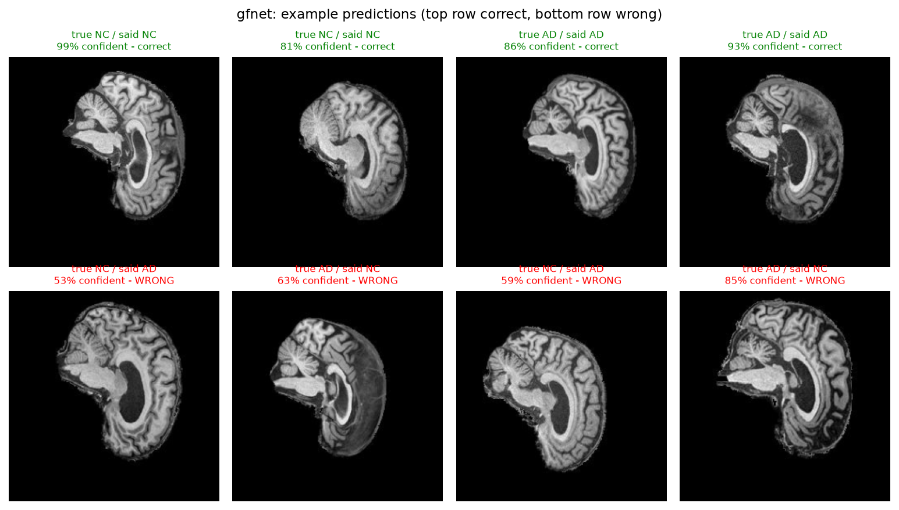

# GFNet for Alzheimer's Classification on ADNI Brain MRI

**Manav Sachdeva (s4967283).** COMP3710 Pattern Analysis Project.
Project 2.1 Classification. Model: GFNet. Difficulty: Hard.

---

## Contents

This page carries the problem, the method, the results and the recommendation.
The detail sits in seven linked pages, so you can go straight to the part you
want.

| Page | What is in it |
|---|---|
| [Feasibility review](docs/feasibility-review.md) | The one-page review from the midpoint check-off, with its acceptance criteria and outcomes |
| [Running the code](docs/running-the-code.md) | Repository layout, dependencies, and every command with its real expected output |
| [The data and the splits](docs/data-and-splits.md) | Dataset layout, why splits are patient-level, and the preprocessing |
| [Dilemma investigation](docs/dilemma-investigation.md) | Brightness ablation, calibration, when temperature scaling hurts, patient-level evaluation, the reject option |
| [Error autopsy](docs/error-autopsy.md) | Named failure patients, what each model did to them, and the one patient that defeats every version |
| [The scan-ID finding](docs/scan-id-finding.md) | Evidence that the filename ID identifies a scan and not a person |
| [Experiment ledger](docs/experiment-ledger.md) | All 20 experiments, including the three that disproved my own hypotheses |

---

## Repository layout

Every file in this submission, and what it is for.

```
recognition/GFNet_s4967283/
|
|-- README.md                     this page
|-- full_report.md                this page and the seven doc pages joined, for submission
|-- GFNet_s4967283_report.docx    the submitted report
|-- progress_log.md               daily log, including the experiments that failed
|-- pr_description.md             the pull request text
|
|-- modules.py                    the model: GFNet blocks, learnable filters,
|                                 the baseline CNN, and six CPU self-tests
|-- dataset.py                    patient-level splitting, transforms, slice stacking
|-- train.py                      training loop, optimisers, warmup, mixup, cutmix
|-- predict.py                    inference, patient-level voting, test-time augmentation
|
|-- evaluate_calibration.py       ECE, reliability diagrams, temperature scaling
|-- visualise_data.py             dataset figures
|-- audit_adni.py                 dataset audit: counts, image sizes, split checks
|-- audit_split_difference.py     compares the validation and test folders on 8 measures
|-- brightness_baseline.py        the brightness-only ablation
|-- find_duplicate_subjects.py    finds near-duplicate patients across splits
|-- measure_leakage_impact.py     measures what the scan-ID leak actually costs
|-- inspect_patient.py            per-patient failure inspection
|-- try_ensemble.py               combines the baseline and GFNet predictions
|
|-- run_train.sh                  SLURM job: training
|-- run_figures.sh                SLURM job: figures and calibration
|-- run_recipe_figures.sh         SLURM job: figures for the recommended model
|-- run_tta.sh                    SLURM job: test-time augmentation
|-- run_smoke.sh                  SLURM job: 2-epoch smoke test
|
|-- docs/
|   |-- running-the-code.md       every command with the output it really prints
|   |-- data-and-splits.md        dataset layout and split design
|   |-- experiment-ledger.md      all 20 experiments
|   |-- dilemma-investigation.md  calibration, patient level, ensemble
|   |-- error-autopsy.md          named failure patients
|   |-- scan-id-finding.md        the scan-ID evidence
|   `-- feasibility-review.md     the midpoint check-off review
|
|-- figures/                      figures for the recommended model
|-- figures_normal_aug/           figures for the original GFNet run
`-- outputs/                      one sample training output
```

These are produced when you run the code, and are not in the repository:
`adni_subset/` (the dataset), `testout_local/`, `outputs_*/`, `__pycache__/`.

---

## The problem

Alzheimer's disease destroys brain tissue. The damage shows up on a structural
MRI scan. The hippocampus gets smaller. The ventricles get larger and fill the
space. The cortex gets thinner. If a computer can find those changes early, a
clinician can start treatment sooner.

This project reads one 2D slice of a T1-weighted brain MRI. It puts the slice
in one of two classes: AD (Alzheimer's Disease) or NC (Cognitively Normal). The
data comes from the ADNI study. ADNI is a North American research programme
that has collected brain scans since 2004.

The hard part is not the difference between a sick brain and a healthy brain.
The hard part is that healthy brains differ a lot from person to person.
Healthy brains also get smaller with normal age. The model must separate "this
brain is sick" from "this brain belongs to a different person".

### The question this report answers

The assignment asks for more than accuracy. The open research question for this
field is about confidence.

> Does the confidence of the model match whether the model is correct? Or does
> the model stay confident when it is wrong? Can a confidence threshold
> automate the easy cases and send the unsure cases to a specialist?

A screening tool with 74% accuracy that knows when it is unsure is more useful
than one with 74% accuracy that always sounds certain. This report measures the
confidence of both models. It then says plainly whether you can trust that
confidence.

---

---

## How GFNet works

A Vision Transformer cuts an image into patches. It then uses self-attention,
so every patch can exchange information with every other patch. That global mix
is the strength of a transformer. But attention costs about n² operations for n
patches.

GFNet keeps the global mix and removes the attention. Each block does three
steps:

1. Take the 2D real FFT of the token grid. The result is complex.
2. Multiply the result by a learnable complex filter of the same shape. These
   weights are the parameters that the model learns. They are frequency gains.
3. Take the inverse FFT back to normal space.

The convolution theorem says that a multiply in the frequency domain equals a
convolution across the whole grid in normal space. So one multiply lets every
patch see every other patch. The cost is n log n instead of n².

### Why this architecture suits this disease

Alzheimer's atrophy is large-scale change in structure. The ventricles get
larger, the cortex gets thinner, the hippocampus gets smaller. These are
low-frequency features.

A model whose parameters are frequency weights is a good match. You can also
look inside it. `predict.py` plots the magnitude of each learned filter, so
this report can show which frequencies the model chose. A convolutional network
gives no equivalent picture.

### One detail that is easy to get wrong

A real-valued input has a symmetric spectrum. `torch.fft.rfft2` uses that fact
and returns only half of the frequencies. For a 14 × 14 token grid the output is
14 × **8**, not 14 × 14.

The learnable filter must match that shape. If the shape is wrong you get a
shape error, or worse, a silent broadcast that trains badly for no visible
reason. `modules.py` holds a self-test for this. The test sets every filter
weight to 1 + 0i and checks that the block returns its input without change. It
passes to within 4.8e-07, which is float32 rounding error.


*Each panel is the learned filter magnitude of one block. Top-left is low
frequency, which means large structures. Bottom-right is high frequency, which
means fine texture.*

---

---

## Results

All numbers come from the held-out test split: 9,000 slices from 450 patients.
No model saw them during training or model selection.

Three models are reported, because they are good at different things and the
difference between them is this report's main finding.

| | BaselineCNN | GFNet, accuracy build | **GFNet, recommended** |
|---|---|---|---|
| Test accuracy, slice | 0.7421 | **0.7450** | 0.7381 |
| Test accuracy, patient | 0.7511 | 0.7578 | **0.7689** |
| Macro F1 | 0.7357 | 0.7367 | 0.7334 |
| AD precision | 0.8411 | 0.8506 | 0.8157 |
| AD recall | 0.5913 | 0.5729 | **0.6092** |
| NC precision | 0.6892 | 0.6854 | 0.6925 |
| NC recall | 0.8903 | **0.9141** | 0.8648 |
| AD cases missed, of 4,460 | 1,823 | 1,905 | **1,743** |
| Best validation accuracy | 0.9028 | 0.8689 | 0.8273 |
| Best epoch of 80 | 79 | 65 | 71 |

**The recommended GFNet wins at patient level by 1.8 points and misses 80 fewer
Alzheimer's cases than the baseline.** It gives up 0.4 points of slice accuracy
to do it.

A clinician classifies a patient, not a slice, so the patient-level row is the
one that matters clinically. The slice row is reported because the
specification's 0.80 target refers to it.

The three differ only in how GFNet was trained:

| Build | Augmentation | Stochastic depth | Mixup | Label smoothing |
|---|---|---|---|---|
| Accuracy build | normal | 0.1 | none | none |
| Recommended | strong | 0.3 | 0.8 | 0.1 |

Both use patch size 8, depth 12, AdamW, and a five-epoch warmup. The
differences and their effects are set out in the
[experiment ledger](docs/experiment-ledger.md).

### Resource profile

| Measure | BaselineCNN | GFNet, recommended | Ratio |
|---------|-------------|--------------------|-------|
| Trainable parameters | 421,474 | 9,117,954 | 21.6× |
| Peak GPU memory | 2.32 GB | 8.76 GB | 3.8× |
| Inference rate | 12,415 img/s | 977 img/s | 0.08× |
| Inference latency | 0.081 ms/img | 1.024 ms/img | 12.6× |
| Seconds per epoch | 13.6 | 62.4 | 4.6× |
| Total training time | 18.1 min | 83.5 min | 4.6× |

**GFNet costs 12.6 times the inference latency for 1.8 points of patient
accuracy.** On a screening queue of a few hundred scans a day that is irrelevant.
977 images a second clears a day's work in well under a second.
It would matter on a device at the bedside.

An earlier, smaller GFNet at patch size 16 used **less** memory than the
baseline, 1.58 GB against 2.32, despite having 11 times more parameters.
Parameters and activations are separate costs. The baseline's first convolution holds a 224 × 224 × 32 feature map, about
1.6 million values per image. GFNet at patch 16 reduces the image to 196 tokens
of 256 values straight away.
Quartering the patch size to 8 raises the token count to 784 and reverses that
advantage.




---

## The four findings that matter

### 1. GFNet is three times better calibrated, and wins at patient level

| Measure | BaselineCNN | GFNet, recommended |
|---|---|---|
| Expected Calibration Error | 0.1812 | **0.0614** |
| Worst single bin gap | 0.2603 | **0.1110** |
| Mean confidence when wrong | 0.8803 | **0.7378** |
| Confidence separation | 0.0579 | **0.0835** |
| Patients wrong on all 20 slices | 40 | **31** |

GFNet predicts better at patient level **and** knows better what it does not
know. Earlier in the project those two properties were split between the two
models, and getting both into one is what the final training recipe bought.

Even so, neither confidence score is good enough to automate on. A separation
of 0.0835 still leaves the right and wrong populations heavily overlapped, so
acceptance criterion 4 is reported as not achievable.

[Read the full investigation &rarr;](docs/dilemma-investigation.md)

### 2. Temperature scaling is a correction, not an improvement

The recommended model's fitted temperature is **0.75**, below 1, meaning
mildly underconfident. Applying temperature scaling to it makes its calibration
**worse**, from 0.0614 to 0.1056.

Every earlier model in this project needed a temperature above 1. One needed
4.59. The method assumes overconfidence, and on a model that has been trained
not to be overconfident it does damage.

That is a condition my earlier recommendation did not carry, and it comes from
a measurement rather than from reading about the method.

### 3. The filename ID identifies a scan, not a person

Near-duplicate patients sit at a median ID gap of 2. Ordinary pairs sit at
47,026. So 16.1% of validation patients share a person with the training set,
even though the patient-level split and its overlap assertion are both correct.

Measured cost: 0.6 points of validation accuracy. **These splits are leak-free
by ID and are not leak-free by subject.**

[Read the evidence &rarr;](docs/scan-id-finding.md)

### 4. The constraint is the cohort, not the model

Twelve GFNet configurations across seven axes: training length, augmentation
strength, weight decay, token resolution, input representation, optimiser and
regularisation recipe.

**Validation moved 8.5 points across them. Test moved 6.1, and not in step with
it.** The run with the highest validation accuracy is not the best on test.

The strongest single piece of evidence: mixup reduced training accuracy from
0.9954 to 0.7759, which is memorisation eliminated, and validation loss stopped
rising. The intervention worked exactly as designed. **Test accuracy did not
improve.**

The best slice-level result is 0.7450, which is 5.5 points short of the 0.80
minimum the specification sets. The campaign is complete rather than abandoned,
and the ledger records all 20 experiments.

[Read the ledger &rarr;](docs/experiment-ledger.md)

---

## Engineering recommendation

**Use GFNet with the recommended training recipe, and do not let it decide
alone.** It beats the baseline at patient level, misses 80 fewer Alzheimer's
cases, and is three times better calibrated. It still does not reach the 0.80
accuracy the specification asks for, and its confidence is still not separable
enough to automate on.

### Which model

| | BaselineCNN | GFNet, accuracy build | **GFNet, recommended** |
|---|---|---|---|
| Patient accuracy | 0.7511 | 0.7578 | **0.7689** |
| Slice accuracy | 0.7421 | **0.7450** | 0.7381 |
| Calibration error | 0.1812 | 0.2231 | **0.0614** |
| AD cases missed | 1,823 | 1,905 | **1,743** |
| Patients wrong on all 20 slices | 40 | 40 | **31** |
| Inference | **12,415 img/s** | 977 img/s | 977 img/s |

The accuracy build holds the best slice accuracy, and that is the number the
0.80 target refers to. It is also the worst calibrated model in the project,
with a fitted temperature of 4.59 and all ten of its most confident mistakes at
exactly 1.0000. For a screening tool that routes uncertain cases to a
specialist, a model that is certain and wrong is the worst thing to have.

**The baseline remains the right choice when inference cost dominates.** It is
12.6 times faster and uses a twentieth of the parameters for 1.8 points less
patient accuracy.

### How to run it

1. **Decide at patient level, not slice level.** Average the 20 slice
   probabilities. It is the clinically meaningful unit and it is worth 3.1
   points for this model, 0.7381 to 0.7689.
2. **Move the AD decision threshold below 0.50.** On the baseline, a threshold
   of 0.10 saves 673 missed AD cases at no cost in overall accuracy. A missed case is the expensive error in screening. The error autopsy
   makes this urgent. Every one of the worst total failures, for every model
   tested, is a patient who has AD.
3. **Do not apply temperature scaling to this model.** Its fitted temperature
   is 0.75, so it is mildly underconfident, and scaling makes its calibration
   error worse, from 0.0614 to 0.1056. Temperature scaling corrects
   overconfidence. Fit the temperature on validation first and apply it only if
   it comes out above 1.
4. **Treat every output as a draft for a specialist.** A confidence separation
   of 0.0835 is the best measured in this project and it is still far too small
   to divide the right and wrong populations cleanly.
5. **Refer any patient the two architectures disagree about.** 23 of the 450 test patients are wrong on all 20 slices for
   both, so an ensemble cannot rescue them. But 17 fail only the baseline and 8
   only GFNet. Disagreement
   between a convolutional model and a frequency-domain model is cheap, and it
   is independent of the confidence score.

**Do not average the two models' probabilities.** The even-split ensemble
reaches 0.7518 at slice level, the best figure in the project, and it is the
wrong trade. Patient accuracy falls to 0.7644 and the number of patients wrong
on all 20 slices rises from 31 to 48. Buying 1.4 slice points by making the
worst failures 55% more common is the opposite of what a screening tool needs.

### Does GFNet earn its cost?

| GFNet is worse at | GFNet is better at |
|---|---|
| Slice accuracy, by 0.4 points | Patient accuracy, by 1.8 points |
| Parameter count, 21.6× more | Calibration error, 0.0614 against 0.1812 |
| Inference latency, 12.6× slower | Confidence separation, 0.0835 against 0.0579 |
| Peak memory, 3.8× more | AD cases missed, 1,743 against 1,823 |

**Yes, for this job.** A screening tool exists to decide which patients a
specialist should see. It is judged on patients rather than slices, on missed
disease rather than overall accuracy, and on whether its confidence can be
trusted. GFNet wins all three, and the cost it pays is inference latency that
is irrelevant at screening volumes.

The honest caveat is that this conclusion rests on 1.8 points of patient
accuracy, measured once, on one seed. The reproducibility test in the ledger puts the noise floor at 0.01 points,
so 1.8 points is real. A three-seed comparison would make it firmer, and that is
the first thing I would add.

### Where the real gain is

Not in either architecture. Twelve GFNet configurations moved test accuracy by
6.1 points in total, and the best of them is 5.5 points short of the target.
Mixup eliminated memorisation completely and test accuracy did not move.

The constraint is the difference between the training cohort and the test
cohort. This report could not explain it, after ruling out folder statistics
and subject leakage. Closing it needs better input, 3D volumes or
widely spaced slices rather than adjacent ones, not a better classifier on a
single 2D slice.

---

## Limitations

**The project did not meet the 0.80 accuracy target.** The best slice-level
result is 0.7450 and the best patient-level result is 0.7689. Twelve GFNet
configurations were tried across seven axes, and the ledger records all of
them. The short version:

| What I tried | Effect on test accuracy |
|---|---|
| 80 epochs instead of 30 | +2.2 points |
| Patch size 8 instead of 16 | +0.6 points |
| AdamW, warmup and stochastic depth | +1.5 points |
| The patient-level mean | +3.1 points |
| 150 epochs instead of 80 | −0.2 points |
| 2.5D, three adjacent slices | −2.4 points |
| Test-time augmentation | −0.06 points |
| Mixup and label smoothing | −0.7 points slice, **+1.1 patient** |

My view on the cause is that the training and test cohorts differ in a way
nothing I measured could reach. One 2D slice does not hold enough information
to bridge that difference. The ADNI literature mostly uses 3D volumes or several
slices. Three adjacent slices did not help here, and the reason is in my own data.
Adjacent slices correlate at 0.9612, so they are near-copies rather than new
information.

**`cudnn.benchmark` is on, and I measured what that costs.** An identical
configuration was accidentally run twice with the same seed. The two runs
differed by **one slice in 9,000**, 0.7450 against 0.7449. So results are not
bit-exact, and the noise floor is 0.01 accuracy points. Differences of 0.3
points and above in this report are real rather than run-to-run variation.

**One seed.** Every result uses seed 42. The measurement above shows the noise
floor is small, but it measures one configuration run twice, not the spread
across seeds. Three seeds per model with a mean and standard deviation would
make the comparison firmer, and it is the first thing I would add.

**The recommendation rests on 1.8 points of patient accuracy** between
BaselineCNN and the recommended GFNet, measured once. It is well above the
noise floor and it is still a single measurement.

**The horizontal flip** assumes a left-right symmetry that Alzheimer's atrophy
does not always keep. It deserves an ablation. Test-time augmentation gives indirect evidence that the model has
learned the symmetry. Averaging a slice with its mirror changed the result by
0.06 points, so the two predictions are nearly identical.

**The splits are leak-free by ID and not by subject.** 16.1% of validation
patients share a person with the training set, because the filename ID
identifies a scan rather than a person. Measured cost: 0.6 points of validation
accuracy and 0.2 points of test accuracy. The linked section sets out the
evidence and the fix I would apply with more time.

**The validation-to-test gap is unexplained.** It is 11 to 16 points depending
on the model. Folder statistics, subject leakage and memorisation were each
tested and none accounts for it. Mixup is the strongest of those tests. It cut training accuracy from
0.9954 to 0.7759 and stopped validation loss rising, so the memorisation was
genuinely removed. Test accuracy did not improve. I am
recording the gap as open rather than attributing it to a cause I cannot
demonstrate.

---

## Artificial Intelligence Usage Disclosure

### Tool used
Anthropic Claude, mainly through an agentic coding session over approximately one week.

### What I used it for
Claude helped me create the initial versions of several project files, including modules.py, dataset.py, train.py, predict.py, evaluate_calibration.py, visualise_data.py, and brightness_baseline.py. These were used as starting points rather than final solutions. I reviewed each file, made edits, corrected mistakes, and adapted the code to fit the requirements of the project.
It also helped generate an early draft of the README structure and some explanatory text, which I substantially revised and rewrote during the final documentation process.
During development, I used Claude as a debugging assistant when dealing with Python errors and configuring SLURM jobs on the university cluster. It was also useful for brainstorming potential analyses, including the brightness-ablation experiment, temperature scaling for calibration, patient-level prediction averaging, and strategies for addressing overfitting.

### How I checked the output
I did not accept Claude's suggestions without verification. The project includes several checks that allowed me to validate the code before running expensive training jobs.
In modules.py, I implemented and ran six self-tests. The most important test sets every GFNet filter weight to 1 + 0i and verifies that the FFT round-trip reconstruction reproduces the original input to within 4.8 x 10^-7. This confirmed that the frequency-domain operations were functioning correctly.
In dataset.py, I used an assertion to ensure that no patient appeared in more than one data split. I also manually checked the reported split sizes. The training and validation splits contained 915 and 161 patients respectively, giving a total of 1,076 patients, which matched the dataset audit.
I independently verified the evaluation metrics by calculating them directly from the confusion matrix. For example, in the baseline model, 4042 + 2637 = 6679 correct predictions out of 9000 samples, giving an accuracy of 0.7421, which matches the reported result.
I also confirmed with teaching staff that the identifiers contained in the filenames correspond to patient IDs, which was important for ensuring that splitting by patient was implemented correctly.
Several Claude-generated suggestions were incorrect and had to be fixed. One example was an invalid SLURM partition recommendation that appeared to come from outdated information. Other mistakes introduced during code edits included a duplicated keyword argument, a stray bracket causing a syntax error, and a missing .to(device) call. Each issue caused failed runs that I then diagnosed and corrected myself.

### What I did myself
I selected the project topic, chose GFNet as the model architecture, and decided to perform the dataset split at the patient level rather than the image level. I carried out the background reading on Alzheimer's disease anatomy that informed the error analysis and interpretation of the results.
All experimental decisions, result interpretation, discussion, conclusions, and recommendations are my own work. While Claude assisted with drafting code, troubleshooting, and generating ideas, I was responsible for verifying every implementation, testing every change, interpreting every result, and deciding what was ultimately included in the final report.
I take responsibility for all code, analyses, and claims presented in this submission.


## References

[1] Y. Rao, W. Zhao, Z. Zhu, J. Lu, J. Zhou, "Global filter networks for image
classification," *IEEE Transactions on Pattern Analysis and Machine
Intelligence*, vol. 45, no. 6, pp. 7837–7850, 2023.

[2] Alzheimer's Disease Neuroimaging Initiative. http://adni.loni.usc.edu

[3] C. Guo, G. Pleiss, Y. Sun, K. Q. Weinberger, "On calibration of modern
neural networks," in *Proc. ICML*, 2017. This paper is the source of the
temperature scaling method and of the Expected Calibration Error metric used in
this report.
