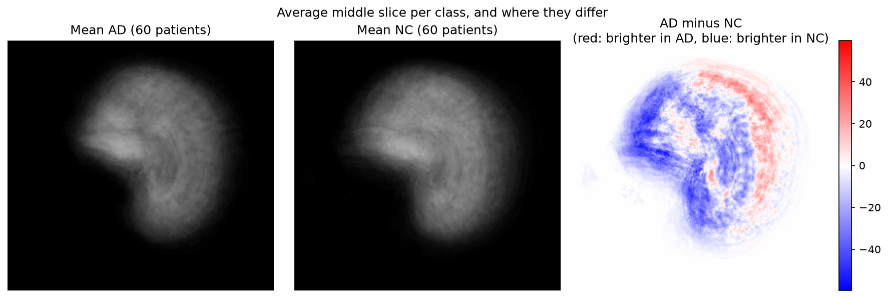

# Investigation of the open research dilemma

[&larr; Back to the main README](../README.md)

---

### Does the model learn anatomy, or brightness?

The intensity histograms show that AD tissue is darker than NC tissue on
average. That raised a question I had to answer before I trusted any result.
Does the model read anatomy, or does it read brightness?

*The average of every AD slice beside the average of every NC slice. The AD
mean shows visibly larger ventricles, which is the structural change the models
are meant to find.*

So I built the simplest classifier I could. `brightness_baseline.py` uses one
number per slice, which is the mean intensity of the tissue pixels. It fits the
threshold on the train split only.

| Classifier | Test accuracy | What it uses |
|---|---|---|
| Chance | 0.500 | nothing |
| Mean tissue brightness | 0.585 | one number per slice |
| GFNet | 0.7122 | learned frequency filters |
| BaselineCNN | 0.7421 | learned convolution features |

The CNN adds **15.7 points** over the brightness rule, so the network learns
real structure. But 0.585 is above chance, so about 8.5 points of the signal is
average brightness. An honest account of this result needs both numbers.

This measurement is also the reason for the brightness jitter in the strong
augmentation setting.

### Does the confidence mean anything?

This is the core of the dilemma. I measured it with `evaluate_calibration.py`.

| Measure | BaselineCNN | GFNet |
|---|---|---|
| Expected Calibration Error | 0.1812 | **0.0934** |
| Worst single bin gap | 0.2603 | **0.1594** |
| Mean confidence when correct | 0.9382 | 0.8281 |
| Mean confidence when wrong | 0.8803 | 0.7499 |
| Separation | 0.0579 | **0.0782** |

**GFNet is almost twice as well calibrated as the baseline.** Its calibration
error is 0.0934 against 0.1812, and its worst single bin is out by 0.159 and not
by 0.260. GFNet is also less overconfident in absolute terms. When GFNet is
wrong it claims 75% certainty, not 88%.

This is the clearest result in the report, and it goes against the accuracy
comparison. The baseline predicts better. GFNet has the better idea of what it
does not know.

**Even so, you cannot automate on either confidence score.** The separation
between right and wrong predictions is 0.078 for GFNet. That is 35% better than
the 0.058 of the baseline. It is still far too small for a threshold to split
the two groups cleanly.

### Temperature scaling

Temperature scaling divides the logits by one learned number before the softmax.
It changes no prediction, so accuracy stays the same. But it can make the
confidence honest.

I fit the temperature on the **validation** split. A fit on test, followed by a
report of test calibration, would be a tune on the test set. That is the same
mistake that the patient-level split exists to avoid.

| Model | Temperature | ECE before | ECE after | Change | Accuracy |
|---|---|---|---|---|---|
| BaselineCNN | 1.20 | 0.1812 | 0.1651 | −8.9% | unchanged |
| GFNet | 1.11 | 0.0934 | 0.0787 | −15.7% | unchanged |

A temperature above 1 means the model was overconfident. Both models were, and
both only mildly. Accuracy did not move for either model, which is the expected
behaviour and a check that the implementation is correct.

GFNet gains more from the fit than the baseline does, at 15.7% against 8.9%. So
some of the overconfidence of the baseline is structural, and a single global
scale does not remove it.

**Strong augmentation did most of the work that temperature scaling would have
done.** I ran the same fit on the normal-augmentation models earlier in the
project. The numbers were very different.

| Run | Temperature | ECE before | ECE after | Change |
|---|---|---|---|---|
| GFNet, normal aug | 1.90 | 0.1819 | 0.1102 | −39% |
| GFNet, strong aug | 1.11 | 0.0934 | 0.0787 | −16% |
| BaselineCNN, normal aug | 1.36 | 0.2164 | 0.1963 | −9% |
| BaselineCNN, strong aug | 1.20 | 0.1812 | 0.1651 | −9% |

The fitted temperature for GFNet fell from 1.90 to 1.11. A temperature near 1
means there is little global overconfidence left to remove. Augmentation and
temperature scaling treat the same problem. Augmentation treats it better,
because it also raises accuracy, and temperature scaling cannot.

So the order matters. Fix the training first, then scale the temperature on
what is left.

### Patient-level evaluation

A clinician classifies a patient and not a slice. Each patient gives 20 slices,
so the mean of those 20 probabilities is the clinically useful read-out.

| Model | Slice | Patient | Gain |
|---|---|---|---|
| BaselineCNN | 0.7421 | **0.7511** | +0.9 pts |
| GFNet | 0.7122 | 0.7444 | **+3.2 pts** |

GFNet gains more than three times as much from the mean. That tells us something
about the shape of the errors of each model. You can see the shape when you
count how each patient fails.

| Model | All 20 slices correct | All 20 slices wrong |
|---|---|---|
| BaselineCNN | 226 | 40 |
| GFNet | 157 | **28** |

The mean only helps a patient whose slices disagree with each other. In the
all-wrong group the model has a consistent and confident misread of the anatomy
of that person. No mean fixes that.

**GFNet gets all 20 slices wrong for 30% fewer patients: 28 against 40.** A
patient who is wrong on all 20 slices is a patient the system gets wrong every
time. There is no internal disagreement to flag the case for review. That is a
real safety property, and GFNet holds it with a lower slice accuracy.

The 3.0-point gap in slice accuracy falls to 0.7 points once you evaluate the
way a clinic would.

### The reject option

The rule is simple. If confidence is at or above a threshold, accept the answer
automatically. Below the threshold, send the case to a specialist.

**Acceptance criterion 4 is not achievable.** No threshold reaches 0.95 accuracy
on the automatic cases and refers 30% of cases or fewer. That follows from the
confidence separation of 0.058. The two groups overlap too much.

The three outcomes do not cost the same. That is why overall accuracy is the
wrong thing to optimise.

| Outcome | Cost |
|---|---|
| False positive, referred | A few minutes of specialist time |
| False positive, auto-flagged | Unnecessary follow-up, patient distress |
| **False negative, auto-cleared** | **A patient goes home with no diagnosis. Nobody checks again.** |

### The decision threshold should move

Both models prefer to say "normal". A move of the AD decision threshold below
0.5 trades NC recall for AD recall.

I measured this on the baseline.

| AD threshold | AD recall | AD precision | NC recall | Accuracy | AD cases missed |
|---|---|---|---|---|---|
| **0.10** | **0.6899** | 0.7598 | 0.7857 | **0.7382** | **1,383** |
| 0.20 | 0.6370 | 0.7909 | 0.8346 | 0.7367 | 1,619 |
| 0.30 | 0.6049 | 0.8149 | 0.8650 | 0.7361 | 1,762 |
| 0.40 | 0.5744 | 0.8315 | 0.8857 | 0.7314 | 1,898 |
| 0.50 (default) | 0.5390 | 0.8492 | 0.9059 | 0.7241 | 2,056 |
| 0.60 | 0.5074 | 0.8628 | 0.9207 | 0.7159 | 2,197 |

At a threshold of 0.10 the model misses 1,383 AD slices and not 2,056. That is
**673 fewer missed cases**, and accuracy goes slightly up and not down.

The default of 0.5 is the wrong operating point for a screening tool.

Note what this does not do. Accuracy stays near 0.73 at every threshold. The
threshold moves errors between the classes. It does not add power to separate
them.

### Overfit: the diagnosis and the fix

The gap from validation to test got wider as training went on. That is the mark
of a model that fits its training group and does not learn something general.

| Baseline run | Validation | Test | Gap |
|---|---|---|---|
| 30 epochs, normal aug | 0.8894 | 0.7241 | 0.165 |
| 80 epochs, normal aug | 0.9326 | 0.7360 | **0.197** |
| 80 epochs, strong aug, weight decay 1e-3 | 0.9028 | 0.7421 | **0.161** |

First I checked whether the two shipped folders differ. The intensity histograms
for the train and test splits look the same, so a shift in the distribution is
not the cause.

The fix was stronger augmentation plus ten times the weight decay. Every measure
moved the right way.

| Measure | Normal aug | Strong aug | Change |
|---|---|---|---|
| Validation | 0.9326 | 0.9028 | −3.0 pts |
| Test (slice) | 0.7360 | 0.7421 | +0.6 pts |
| Test (patient) | 0.7422 | 0.7511 | +0.9 pts |
| Gap | 0.197 | 0.161 | −3.6 pts |
| AD recall | 0.5466 | 0.5913 | **+4.5 pts** |
| Macro F1 | 0.7257 | 0.7357 | +1.0 pts |
| ECE | 0.2164 | 0.1812 | −16% |
| Confidence separation | 0.0408 | 0.0579 | **+42%** |

Validation fell and test rose. That is what less overfit looks like. AD recall
gained the most, and that is the measure that matters in a clinic. It means 199
fewer missed Alzheimer's cases.

---
