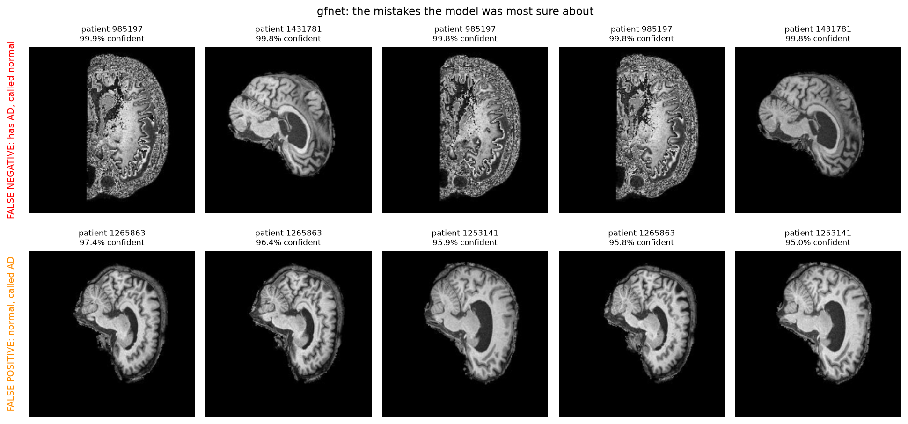

# Error autopsy

[&larr; Back to the main README](../README.md)

---

`predict.py` selects the mistakes that the model was **most confident** about,
because those are the dangerous ones. A mistake at 51% confidence goes to a
human under any sensible threshold. A mistake at 99% confidence does not.

`inspect_patient.py` then prints every slice of a named patient for both
models. That separates a patient the model is unsure about from a patient the
model is confidently and completely wrong about.

**Which models this section covers.** Findings 1 to 4 and the image
observations below were made on BaselineCNN and the original depth-8 GFNet. The
recommended model came later and fails on different patients, which is itself a
finding and is recorded at the end.

### Finding 1. The baseline reached P(AD) = 0.0000 on a patient who has AD

Patient 985197 has Alzheimer's disease. The baseline gave this output.

| Model | Correct slices | Mean P(AD) | Min | Max |
|---|---|---|---|---|
| BaselineCNN | **0 of 20** | **0.0000** | 0.0000 | 0.0000 |
| GFNet | 0 of 20 | 0.0086 | 0.0010 | 0.0290 |

Every one of the 20 slices returned a probability below 0.00005. The softmax
saturated. The model did not report low confidence in Alzheimer's. It reported
none at all, twenty times, on twenty different images of a sick brain.

GFNet is also wrong on all 20 slices, and it is wrong by a factor of about 30
less. It never claims certainty.

This single patient is the clearest answer to the research question in this
report. A confidence score that reads 1.0000 while the answer is wrong carries
no information at all.

### Finding 2. Every catastrophic failure is a missed AD case

I listed the ten worst total failures for each model. A total failure is a
patient the model gets wrong on all 20 slices.

**All twenty entries, across both models, are patients who have AD.** Not one
healthy patient appears in either list.

| Model | Worst patient | True class | Mean distance from the truth |
|---|---|---|---|
| BaselineCNN | 985197 | AD | 1.0000 |
| BaselineCNN | 1240482 | AD | 0.9996 |
| BaselineCNN | 1398870 | AD | 0.9994 |
| GFNet | 985197 | AD | 0.9914 |
| GFNet | 1240482 | AD | 0.9856 |
| GFNet | 1061844 | AD | 0.9855 |

The failures are not spread evenly between the classes. When either model fails
completely, it fails by calling a sick person healthy. That is the expensive
direction, and it is the direction the cost table above names as the worst
outcome.

This is the measurement that justifies the threshold recommendation. A model
whose total failures are all false negatives must not run at a decision
threshold of 0.5.

### Finding 3. Twenty patients defeated both of the early architectures

| Group | Patients |
|---|---|
| Wrong on all 20 slices, BaselineCNN only | 20 |
| Wrong on all 20 slices, GFNet only | 8 |
| Wrong on all 20 slices, **both models** | **20** |
| Either model fails completely | 48 of 450 |

The 20 shared patients are a property of those scans and not of one
architecture. A convolutional network and a frequency-domain network, which
read an image in completely different ways, agree on every slice of all 20.

That sets a floor. An ensemble of the two models would still fail on those 20
patients, which is 4.4% of the test set. The other 28 failures are
architecture-specific, so an ensemble could recover some of them.

### Finding 4. The two models fail in different shapes

Patient 1274602 is healthy. Both models call the patient sick, but not in the
same way.

| Model | Correct slices | Mean P(AD) | Range across slices |
|---|---|---|---|
| BaselineCNN | 0 of 20 | 0.9656 | 0.767 to 0.998 |
| GFNet | 11 of 20 | 0.5402 | 0.216 to 0.921 |

The baseline is wrong on every slice and sure of itself on every slice. GFNet is
right on more than half the slices and sits near the fence on the rest. The
patient-level mean still lands on the wrong side for GFNet, at 0.5402, but it
lands there by 0.04 and not by 0.47.

The same shape appears for patient 1265863. The baseline is correct on 1 slice
of 20 at a mean of 0.8747. GFNet is correct on 2 of 20 at a mean of 0.7387.

**The baseline fails with certainty. GFNet fails with doubt.** The calibration
numbers earlier in this report, an ECE of 0.1812 against 0.0934, are an average
over 9,000 slices. These four patients are what that average looks like in one
case at a time.

### What the images show

Looking at the false negative cases, patient 985197 is quite interesting because the scan does not immediately stand out as having the classic appearance people would associate with Alzheimer's disease. The ventricles are visible but do not look dramatically enlarged, and there is no obvious severe cortical thinning from this single slice. What stands out more is the image quality itself. The scan is much noisier and higher contrast than the others, making it look somewhat unusual, but the underlying brain anatomy still appears ordinary. The slice seems to come from the middle portion of the brain because there is still a substantial amount of brain tissue visible, and the head is positioned reasonably well with only minor off centering.
Patient 1431781 also looks relatively ordinary when viewed anatomically. The ventricles appear moderately enlarged, but not to a degree that immediately screams Alzheimer's disease. The cortex still looks reasonably preserved, and although the hippocampal region cannot be clearly evaluated from this view alone, there is nothing dramatically abnormal visible. The image brightness appears normal compared to the surrounding scans, and the slice is likely taken near the centre of the brain because major internal structures are clearly visible.
The false positive cases all seem to share a different pattern. Patient 1265863 has a relatively large ventricular space, and some of the surrounding tissue gives the impression of mild atrophy. Even though the patient is normal, I can understand why the model was fooled because the anatomy visually resembles features often associated with Alzheimer's disease. The scan also appears brighter than what would be expected from an average normal-control image. The head is positioned well, and the slice appears to be from the middle of the scan stack where the largest amount of anatomical information is visible.
Patient 1253141 shows a similarly large ventricle and relatively open-looking spaces around the central part of the brain. The cortex appears slightly thinner than some other examples, although not enough to confidently diagnose disease from visual inspection alone. Like patient 1265863, the image looks brighter overall, which is important because the earlier brightness experiment suggested that intensity alone carries some predictive information. The scan is well centred and appears to be a central sagittal slice.
Patient 1243833 displays much the same behaviour. The ventricles are clearly visible and somewhat enlarged, while the cortex remains reasonably intact. Nothing in the image looks extreme, but it does contain several characteristics that could push a classifier toward an Alzheimer's prediction. The image brightness also seems relatively high, and the head position and slice selection look normal.
Patient 1274602 is probably the strongest example of this pattern. The ventricular region is quite large and dark, making the brain look more similar to the Alzheimer's examples than to a typical healthy control. The cortex also appears somewhat thin in several areas. On top of that, the image brightness is noticeably high, particularly in the white matter regions. This supports the idea that brightness may have contributed to the model's confident mistake.
For the first question, I would say patient 985197 looks somewhat unusual because of the image quality rather than because of the anatomy. The heavy noise and contrast make the scan visually different from most of the others, but the actual brain structures appear relatively ordinary. That makes this a difficult error to explain. If the scan contained obvious Alzheimer's-related atrophy, the model's prediction would at least make some intuitive sense. Instead, the anatomy looks normal while both models remain extremely confident, which suggests they may be responding to features that are not immediately obvious to a human observer.
For the second question, both patient 1274602 and patient 1265863 appear brighter than the normal-control average. The white matter regions are particularly bright, and the overall contrast is stronger than expected. Since the brightness-only experiment achieved an accuracy of 0.585, these examples provide visual evidence that image intensity could be influencing the model's decisions. I would not claim brightness is the sole reason for the errors, but it is a plausible contributing factor.
For the third question, the false negatives do seem to share a visible trait. Neither patient 985197 nor patient 1431781 displays the kind of obvious ventricular enlargement or severe cortical thinning that many people associate with Alzheimer's disease. Their brains look relatively ordinary from these slices, which may explain why the model incorrectly classified them as normal. In contrast, many of the false positives have ventricles that look larger or more AD-like despite belonging to normal patients. This suggests the model may rely heavily on visible structural changes and struggle when Alzheimer's disease presents more subtly.
Overall, I would not trust this prototype to handle borderline cases where Alzheimer's-related changes are subtle, image brightness differs from the training average, or normal ageing produces brain structures that visually resemble mild atrophy.

---

---

### Finding 5. Training the overconfidence out changed who fails

The recommended model, trained with mixup, cutmix and label smoothing, fails on
a different set of patients and in a visibly different way.

| | Accuracy build | Recommended |
|---|---|---|
| Highest confidence on a false negative | **1.0000** | 0.9810 |
| Highest confidence on a false positive | **1.0000** | 0.9645 |
| Patients wrong on all 20 slices | 40 | **31** |
| Calibration error | 0.2231 | **0.0614** |

**The accuracy build puts all ten of its worst mistakes at exactly 1.0000.**
Five patients it is certain do not have Alzheimer's who do, and five it is
certain do who do not. The recommended model's worst mistake is 0.9810, and
nothing it gets wrong reaches certainty.

That difference is the whole argument for the recommended model in one number.
Both are wrong about roughly the same number of slices. One of them says so.

### Finding 6. Patient 1265863 defeats every version

Patient 1265863 is in my own image observations above. I wrote that it has a
relatively large ventricular space and looks brighter than a normal control. I
also wrote that it resembles the Alzheimer's examples closely enough that I
understood why the model was fooled.

It is still there. It appears among the most confident false positives for the original depth-8
GFNet. It appears again for the recommended model, after every regulariser in
this report had been applied.

A patient that defeats one training run is a weakness of that run. A patient
that defeats three separate training recipes, including one that eliminated
memorisation entirely, is a property of the scan. Combine that with the 23 patients wrong on all 20 slices for both
architectures. Together they are the clearest evidence in this report that some
cases are not reachable by a better classifier on a single 2D slice.

### Finding 7. Every worst failure is still a missed AD case

The lists change, the direction does not. For the recommended model:

> False negatives: 1330894, 1398870, 1240482, 1017725, 1342389
> False positives: 1265863, 1199414, 1441119, 1215774

And the five worst total failures, the patients wrong on all 20 slices and
furthest from the truth, are 1398870, 1240482, 1342389, 992839 and 1223029.
**All five have AD.**

That has held for every model tested in this project. When any of them fails
completely, it fails by calling a sick person healthy. It is the expensive
direction, and it is why the recommendation moves the decision threshold below
0.50 rather than leaving it where the softmax puts it.
